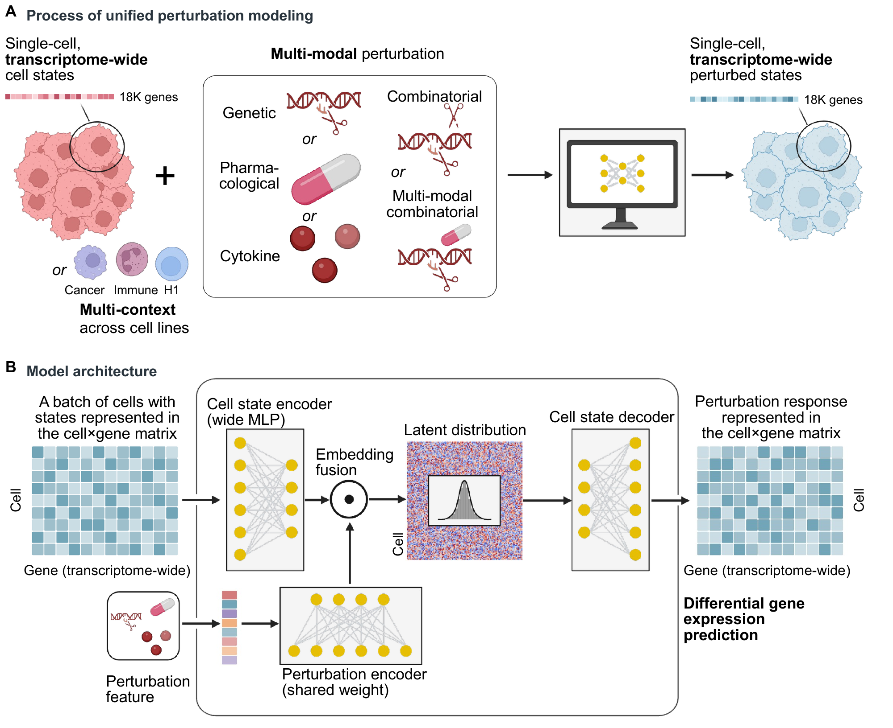

<div align="center">

<h1>UPM</h1>
<h3>Unified Perturbation Modeling</h3>

<p align="center">
<a href="https://github.com/youlab2025/UPM"></a>&nbsp;&nbsp;<a href="https://huggingface.co/youlab2025/UPM/tree/main"></a>&nbsp;&nbsp;<a href="#installation"></a>&nbsp;&nbsp;<a href="#python-api"></a>&nbsp;&nbsp;<a href="#checkpoint"></a>&nbsp;&nbsp;<a href="#inputs-and-outputs"></a>
</p>

<p align="center">
<picture></picture>&nbsp;<a href="https://github.com/youlab2025/UPM"><strong>GitHub Code</strong></a>&nbsp;&nbsp;|&nbsp;&nbsp;<picture></picture>&nbsp;<a href="https://huggingface.co/youlab2025/UPM"><strong>Hugging Face Checkpoints</strong></a>&nbsp;&nbsp;|&nbsp;&nbsp;<picture></picture>&nbsp;<a href="https://www.biorxiv.org/content/10.64898/2026.10.25.761625v1"><strong>Paper</strong></a>
</p>

<p>
  <a href="#overview">Overview</a> ·
  <a href="#installation">Installation</a> ·
  <a href="#checkpoint">Checkpoint</a> ·
  <a href="#quickstart">Quickstart</a> ·
  <a href="#python-api">Python API</a> ·
  <a href="#citation">Citation</a>
</p>

<p><i>How Much Can AI Virtual Cells Gain from Unified Perturbational Modeling?</i></p>

</div>

## Overview

**UPM predicts single-cell transcriptomic responses to genetic, chemical, and cytokine interventions within a shared framework.** It combines the starting cell state with a perturbation representation and decodes the resulting expression profile. Combined interventions supply multiple perturbation inputs to the same model.

This repository provides the **UPM inference implementation** for the standalone checkpoint used in the paper. 
<p align="center">
  <a href="assets/fig1_ab.pdf">
    
  </a>
</p>

| Intervention | Input | Inference behavior |
| :--- | :--- | :--- |
| **Gene editing** | A gene name and `crispri` or `crispra` | Predict repression or activation responses. |
| **Chemical** | A molecule name and dose in **nM** | Predict dose-conditioned responses. |
| **Cytokine** | A cytokine name | Predict stimulation responses using its fixed embedding. |
| **Combination** | Multiple perturbations in one condition | Average component perturbation representations before decoding. |

Perturbation names must be present in the checkpoint vocabulary. The bundle includes the fixed embeddings needed for inference.

## Installation

Use **Python 3.10–3.12**. For CUDA inference, install a compatible PyTorch build using the [official PyTorch installation guide](https://pytorch.org/get-started/locally/) before installing UPM.

```bash
conda create -n upm python=3.11 -y
conda activate upm

git clone https://github.com/youlab2025/UPM.git
cd UPM
python -m pip install -e .

upm-infer --help
```

<details>
<summary><b>Install directly from GitHub</b></summary>

```bash
python -m pip install git+https://github.com/youlab2025/UPM.git
```

The examples below assume a repository checkout, which includes the VCC example dataset. With a direct installation, supply your own control cells and conditions JSON file.

</details>

## Checkpoint

The complete inference checkpoint is hosted at **[youlab2025/UPM on Hugging Face](https://huggingface.co/youlab2025/UPM)**, together with a copy of the VCC example dataset. The portable bundle is approximately **4.8 GB** and includes the inference weights and required fixed embeddings.

The checkpoint repository currently requires authorized access. Log in with your own Hugging Face account, then download all six checkpoint files with one command:

```bash
hf auth login
upm-download --revision 689cbbc8500e3b4f5ed7f7fad3ce1f2d299bd514 --output checkpoints/upm
```

If your Hub installation provides `huggingface-cli` instead of `hf`, use `huggingface-cli login`.

`upm-download` verifies file completeness and SHA-256 checksums before reporting success. Downloads can be resumed by running the same command again. To pin a release, add `--revision <HF-commit-hash>`. Allow approximately **10 GB of free disk space** for the Hub cache and independent local copy. `--local-files-only` requires the requested revision to be present in the Hub cache.

A portable checkpoint contains these six files:

```text
checkpoints/upm/
├── config.json           # UPM architecture and dimensions
├── genes.json            # Expression gene channels and aliases
├── perturbations.json    # Gene, molecule, and cytokine vocabularies
├── embeddings.npz        # Fixed perturbation embeddings
├── model.safetensors     # Inference weights
└── manifest.json         # File checksums and bundle metadata
```

Load the whole bundle with `UPM.from_pretrained("checkpoints/upm")`. The loader verifies file checksums and architecture compatibility. Inference loads Safetensors and NumPy arrays without pickle or a training framework.

The same loader also accepts `UPM.from_pretrained("youlab2025/UPM", revision=...)`, or `--model youlab2025/UPM` and `--revision` on the CLI, and downloads the checkpoint automatically when needed. Use an explicit Hugging Face commit revision for reproducible runs. `--local-files-only` loads an existing local bundle or cached snapshot without downloading.

## Quickstart

### 1. Use the VCC example

A small example from the [Virtual Cell Challenge 2025](https://github.com/ArcInstitute/arc-virtual-cell-atlas/blob/main/virtual-cell-challenge/README.md) **H1 human embryonic stem cell training split** is included in [examples/vcc](examples/vcc). It contains 32 non-targeting control cells and 32 observed cells each for **STAT1**, **MED12**, and **TADA1** CRISPRi, sampled without replacement with seed 0.

| File | Contents |
| :--- | :--- |
| [controls.h5ad](examples/vcc/controls.h5ad) | 32 control cells used as the inference input. |
| [observed.h5ad](examples/vcc/observed.h5ad) | 96 separate, experimentally observed perturbation cells for inspection. |
| [conditions.json](examples/vcc/conditions.json) | The three CRISPRi conditions to predict. |
| [provenance.json](examples/vcc/provenance.json) | Data source, sampled rows, normalization, and file checksums. |

Both AnnData files retain all **17,956 measured genes** from the processed source. `.X` is already **`log1p(CP10K)`**, `.var_names` contains Ensembl gene IDs, and `.var["gene_name"]` contains gene symbols. Use `--input-space log1p-cp10k` for this example.

### 2. Define interventions

Each condition has a unique `id` and a nonempty list of `perturbations`. The VCC example's [conditions.json](examples/vcc/conditions.json) contains:

```json
[
  {
    "id": "STAT1_CRISPRi",
    "perturbations": [{"type": "crispri", "name": "STAT1"}]
  },
  {
    "id": "MED12_CRISPRi",
    "perturbations": [{"type": "crispri", "name": "MED12"}]
  },
  {
    "id": "TADA1_CRISPRi",
    "perturbations": [{"type": "crispri", "name": "TADA1"}]
  }
]
```

For a combination, put its components in the **same** `perturbations` list. For a chemical intervention, also provide a numeric `dose` in nM; cytokines do not take a dose field. See [Python API](#python-api) for examples.

### 3. Predict

After downloading the checkpoint with `upm-download --revision 689cbbc8500e3b4f5ed7f7fad3ce1f2d299bd514 --output checkpoints/upm`, run the included example:

```bash
upm-infer \
  --model checkpoints/upm \
  --control examples/vcc/controls.h5ad \
  --conditions examples/vcc/conditions.json \
  --input-space log1p-cp10k \
  --device cpu \
  --batch-size 32 \
  --output predictions.h5ad
```

This produces **96 predicted cells × 17,956 genes**: 32 predictions per condition, using the same control-cell pool. The observed perturbation cells in `observed.h5ad` are sampled independently and can be inspected alongside the predictions.

Use `--device cuda` for GPU inference, or `--device auto` to select CUDA when available.

To download automatically during inference, replace `--model checkpoints/upm` with `--model youlab2025/UPM` in the command above. Authenticate first if required.

### 4. Use your own cells

Supply a **control-only** AnnData file from the cell context you want to perturb and a conditions JSON file. By default, UPM reads `.X` and uses Ensembl identifiers in `.var_names`.

- For raw counts, set `--input-space counts` and keep all measured gene columns when normalizing. If counts are in `.layers["counts"]`, also add `--layer counts`.
- For expression already in `log1p(CP10K)`, set `--input-space log1p-cp10k`.
- If Ensembl IDs are stored in `.var["ensembl_id"]`, add `--gene-id-column ensembl_id`.

Each condition uses the same supplied control-cell pool. With two conditions and 1,000 controls, the output contains 2,000 predicted cells in the input gene order.

## Python API

Load, align, and predict. Gene alignment is performed **once per model instance**; load a fresh instance to use a different gene panel.

```python
import anndata as ad

from upm import UPM, Perturbation
from upm.preprocessing import prepare_controls

adata = ad.read_h5ad("examples/vcc/controls.h5ad")
controls = prepare_controls(adata.X, input_space="log1p-cp10k")

model = UPM.from_pretrained("checkpoints/upm", device="cpu")
model.align_genes(adata.var_names.tolist())  # Ensembl IDs, in input column order

predicted = model.predict(
    controls,
    Perturbation(type="crispri", name="STAT1"),
    batch_size=32,
)

# Float32 log-expression, with the same cells × genes shape as controls.
print(predicted.shape)
```

Inspect available perturbations before choosing a condition:

```python
print(model.perturbations["genes"][:10])
print(model.perturbations["molecules"][:10])
print(model.perturbations["cytokines"][:10])
```

<details>
<summary><b>Gene × gene, gene × drug, and cytokine examples</b></summary>

These examples reuse `model` and `controls` from above. Choose names from the loaded bundle's vocabulary.

```python
# Gene × gene: two interventions in one prediction.
gene_pair = model.predict(controls, [
    Perturbation("crispri", "TP53"),
    Perturbation("crispra", "MYC"),
])

# Gene × drug: 1,000 nM = 1 µM.
drug_name = model.perturbations["molecules"][0]
gene_drug = model.predict(controls, [
    Perturbation("crispri", "TP53"),
    Perturbation("molecule", drug_name, dose=1000),
])

# Cytokine stimulation: no dose field.
cytokine_name = model.perturbations["cytokines"][0]
cytokine = model.predict(controls, Perturbation("cytokine", cytokine_name))
```

</details>

## Inputs and outputs

| Item | Contract |
| :--- | :--- |
| **Control expression** | Nonempty cells × genes matrix. The CLI accepts counts or `log1p(CP10K)`; the Python `predict` method expects `log1p(CP10K)`. `prepare_controls` handles dense and sparse inputs and returns dense float32 arrays. |
| **Gene identifiers** | Exact checkpoint identifiers, normally Ensembl IDs. The CLI uses `.var_names` or a specified `.var` column. For multiple aliases per input column, use `--gene-aliases` with a JSON list of alias lists, or pass alias lists to `align_genes`. |
| **Molecule dose** | Explicit, finite, nonnegative dose in **nM**. |
| **Missing genes** | By default, unmatched genes retain their control expression after the model's native normalization. `--unknown-gene error` requires complete coverage. A panel with no matching genes is rejected. |
| **Unknown perturbations** | Rejected by default. `--unknown-perturbation control` explicitly returns controls for an unsupported whole condition, including a combination with any unsupported component. |
| **Prediction mode** | Float32 inference using the deterministic VAE mean. |

The CLI writes a new `.h5ad` file with:

- **`.X`** — predicted log-expression, grouped by condition and preserving control-cell order within each condition.
- **`.obs`** — input cell annotations plus `condition_id`, `control_id`, and `control_row`.
- **`.var`** — input gene annotations plus the `upm_covered` coverage flag.
- **`.uns["upm"]`** — model source, conditions, normalization, and inference settings.

Output genes remain in the input order. Predictions undergo native CP10K normalization followed by control-value restoration for uncovered genes, matching the Figure 2D inference contract. Consequently, the final count-space row sum can differ from 10,000 when uncovered genes are present. The CLI refuses to overwrite an existing output file.

## Advanced: exporting a legacy checkpoint

<details>
<summary><b>For owners of a trusted UPM training checkpoint</b></summary>

Convert `args.pt`, `ensgids_all.pt`, and `best.ckpt` together with the exact perturbation embedding assets used for that checkpoint:

```bash
upm-export \
  --checkpoint-dir /path/to/upm/checkpoint \
  --embedding-dir /path/to/matching/embedding-assets \
  --output checkpoints/upm \
  --trust-legacy-pickle
```

The trust flag authorizes loading legacy pickle files, which can execute Python code; use it only with trusted checkpoint and embedding files. The exporter retains inference weights and embedding assets and discards optimizer state. Regular inference uses the resulting portable bundle.

</details>

## Repository guide

| Path | Contents |
| :--- | :--- |
| [src/upm/model.py](src/upm/model.py) | UPM model and perturbation interface. |
| [src/upm/cli.py](src/upm/cli.py) | Control-only H5AD inference. |
| [src/upm/bundle.py](src/upm/bundle.py) | Local and Hugging Face bundle loading. |
| [src/upm/download.py](src/upm/download.py) | Complete checkpoint download with checksum verification. |
| [src/upm/preprocessing.py](src/upm/preprocessing.py) | Expression validation and count normalization. |
| [src/upm/export.py](src/upm/export.py) | Conversion of trusted legacy UPM checkpoints. |
| [examples/](examples/) | CLI entry point and example conditions. |
| [tests/](tests/) | Model, preprocessing, checkpoint, and CLI checks. |

For usage questions or reproducible problems, [open a GitHub issue](https://github.com/youlab2025/UPM/issues) with the command, package versions, and error message.

## Resources

- **Inference code and full usage guide:** [youlab2025/UPM on GitHub](https://github.com/youlab2025/UPM)
- **Checkpoint and example files:** [youlab2025/UPM on Hugging Face](https://huggingface.co/youlab2025/UPM/tree/main)
- **Open-X-Cell:** [Training and inference code](https://github.com/zongtingwei/Open-X-cell) · [Model checkpoints and examples](https://huggingface.co/zongting/Open-X-Cell)
- **Questions and reproducible issues:** [GitHub Issues](https://github.com/youlab2025/UPM/issues)
- **License:** [CC BY-NC 4.0](https://github.com/youlab2025/UPM/blob/main/LICENSE) (Creative Commons Attribution-NonCommercial 4.0 International).

## Citation

**Paper:** [bioRxiv](https://www.biorxiv.org/content/10.64898/2026.10.25.761625v1) · **DOI:** [10.64898/2026.10.25.761625](https://doi.org/10.64898/2026.10.25.761625)

If you use this code, please cite our paper.

```bibtex
@article{wei2026much,
  title={How Much Can AI Virtual Cells Gain from Unified Perturbational Modeling?},
  author={Wei, Zongting and Ye, Yuedian and Cui, Shuguang and Ma, Wenjing and You, Yuning},
  journal={bioRxiv},
  year={2026},
  publisher={Cold Spring Harbor Laboratory}
}
```

## ⭐ Star

If you find this work helpful, please consider giving me a ⭐!
